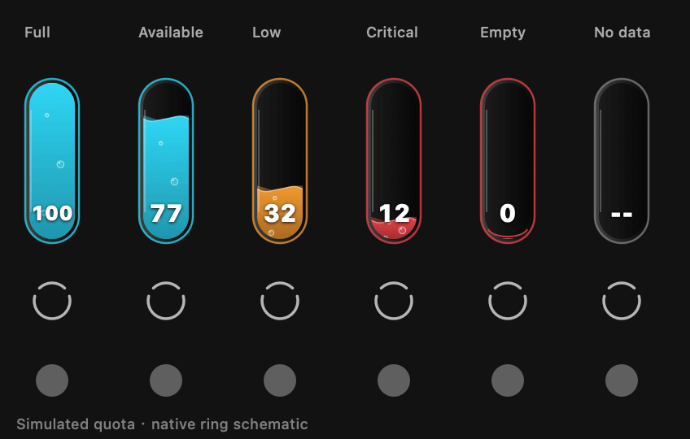

# Recreate QuotaDock

[中文](recreate-prompt.md) | **English**

Build a macOS quota overlay with Swift/AppKit. Place a 36×104 pt glass capsule above the ChatGPT/Codex avatar, with a 70 pt gap above the avatar and roughly 20 pt separation from the current native usage ring. Read server quota every 5 seconds while the main window is visible, otherwise every 30 seconds through the local Codex CLI's official account/rateLimits/read method, selecting five-hour otherwise weekly limits, excluding Spark and preserving source fractions. Represent remaining quota with the liquid height, two surface waves, and rising bubbles. At the bottom, show only a whole number, with no percent sign or background plate. Use a white up-to-15 pt monospaced heavy font with a diffuse black shadow, shrinking long values to leave space at the sides. Use cyan for at least 50%, amber for 20% to below 50%, and red below 20%. Animate level changes over 0.6 seconds, pause when the target window is hidden, and keep the liquid still when Reduce Motion is enabled. Allow authoritative increases and decreases. Show unknown on failure, after one minute, or at reset; do not use old logs or a persistent quota cache. Bound child processes and timeouts, check identity before and after reads, and never read tokens directly. Include tests and repeatable build, signing, and packaging scripts.

