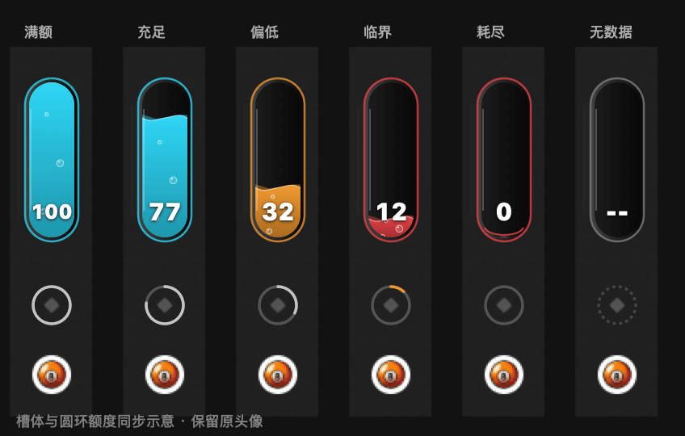

# 用 Codex 复刻

**中文** | [English](recreate-prompt.en.md)

用 Swift/AppKit 做一个 macOS 额度悬浮窗。在 ChatGPT/Codex 头像正上方放一根 36×104 pt 的玻璃胶囊，距头像顶部 70 pt，与当前原生用量圆环留出约 20 pt 间隔。主窗口可见时每 5 秒、隐藏时每 30 秒通过本机 Codex CLI 的官方 account/rateLimits/read 读取服务端额度，优先 5 小时、否则每周，过滤 Spark，保留服务端小数。用液面高度表示剩余百分比，加两层波动和上浮气泡。底部仅显示整数数值，不加百分号或底板，使用最多 15 pt 白色等宽重体与扩散黑色阴影，长数值自动缩小以留出空隙。至少 50% 为青蓝色，20% 到 49% 为橙，低于 20% 为红。液位变化用 0.6 秒缓动，窗口隐藏时暂停，系统减少动态效果时保持静止。允许服务端修正上升或下降；失败、超过一分钟或周期重置时显示未知，不读取旧日志或跨重启缓存。使用受控子进程和超时，读取前后核对登录身份，不读取令牌。附离线协议测试、构建、签名和打包脚本。

